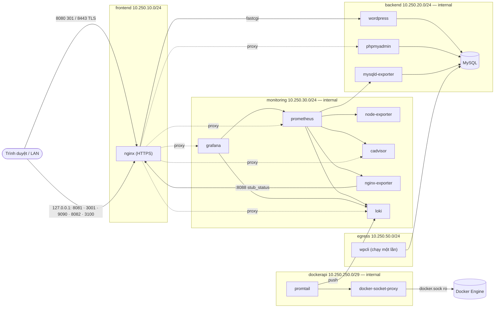

# Website Quảng bá Sản phẩm (WordPress) — Docker Compose

Bài tập lớn môn **Triển khai và Quản trị Hệ thống Phần mềm** — Đề 3.

| | |
|---|---|
| Sinh viên | NGUYỄN ANH PHÚC |
| MSSV | dtc245010034 |
| Lớp | KTMT K23 |
| GVHD | HOÀNG VĂN TÂM |
| Repo | https://github.com/dtc245010034-rgb/cuoiky-dtc245010034 |

## Giới thiệu
Website quảng bá sản phẩm **PhucTech Smart Home** (thiết bị nhà thông minh, thương hiệu giả định) xây dựng bằng WordPress + WooCommerce ở chế độ *catalog* (chỉ giới thiệu: ảnh, giá, mô tả, danh mục; không giỏ hàng/thanh toán). Toàn bộ hệ thống — website, cơ sở dữ liệu, phpMyAdmin, Nginx HTTPS tự ký, giám sát (Prometheus + Grafana) và log tập trung (Loki + Promtail) — chạy bằng **một lệnh `docker compose up -d`**.

## Kiến trúc

Một số container nối nhiều mạng (sơ đồ chỉ vẽ mạng chính): `nginx` nối `frontend` + `backend` + `monitoring`; `mysqld-exporter` nối `backend` + `monitoring` (chỉ để tới `db:3306`); `promtail` nối `dockerapi` + `monitoring`; `wpcli` nối `backend` + `egress`. Cả 5 mạng dùng subnet cố định (dải `10.250.0.0/16`, không trùng LAN/tailscale/bridge mặc định). Mã WordPress nằm trong volume `wp_html` dùng chung (Nginx gắn chỉ-đọc).

## Dịch vụ, cổng và vai trò
Chỉ Nginx 8080/8443 mở ra ngoài; mọi công cụ quản trị bind `127.0.0.1` và đi qua Nginx.

| Dịch vụ | Image | Cổng (host) | Vai trò |
|---|---|---|---|
| `nginx` | `nginxinc/nginx-unprivileged:1.30.6-alpine` | 8080 (→ 301), 8443 (TLS); `127.0.0.1`: 8081, 3001, 9090, 8082, 3100 | Reverse proxy HTTPS, security headers, giới hạn tốc độ, cổng vào các công cụ quản trị |
| `wordpress` | `wordpress:7.1.3-php8.4-fpm` | — | Website (php-fpm, uid 33) |
| `db` | `mysql:8.4.13` | — (không publish) | MySQL, user riêng quyền tối thiểu |
| `phpmyadmin` | `phpmyadmin:5.2.3-apache` | `127.0.0.1:8081` | Quản trị DB |
| `prometheus` | `prom/prometheus:v3.15.1` | `127.0.0.1:9090` | Thu thập metric, 7 rule cảnh báo, giữ 7 ngày |
| `grafana` | `grafana/grafana:13.2.4` | `127.0.0.1:3001` | Dashboard (nạp bằng file provisioning) |
| `node-exporter`, `cadvisor`, `nginx-exporter`, `mysqld-exporter` | `v1.12.1`, `v0.60.6`, `1.5.3`, `v0.21.0` | `127.0.0.1:8082` (cAdvisor) | Metric máy chủ / container / Nginx / MySQL |
| `loki` | `grafana/loki:3.7.9` | `127.0.0.1:3100` (chỉ đọc) | Lưu log, ruler cảnh báo log, giữ 7 ngày |
| `promtail` | `grafana/promtail:3.6.11` | — | Thu log container qua Docker API |
| `docker-socket-proxy` | `wollomatic/socket-proxy:1.13.1` | — | Cho Promtail đọc Docker API với allowlist `GET` |
| `log-init`, `wpcli` | (image Promtail, `wordpress:cli-2.12.0-php8.4`) | — | Chạy một lần: chown volume positions; cài WordPress + nội dung mẫu (profile `setup`) |

Image đều pin tag cụ thể; mọi dịch vụ chạy thường có `restart: unless-stopped`, `mem_limit` (tổng ~3 GB) và healthcheck (trừ `loki` và `nginx-exporter`: image distroless/scratch không có shell, theo dõi bằng metric `up` + rule `TargetDown`).

## Yêu cầu hệ thống
- Docker Engine + Docker Compose v2 (`docker compose`), user thuộc group `docker`
- ≥ 4 GB RAM trống, ≥ 15 GB đĩa trống (đã chạy trên máy 7,7 GB RAM, Docker 29.1.3, Compose 2.40.3)
- Cổng 8080, 8443, 8081, 3001, 9090, 8082, 3100 còn trống
- `openssl` (sinh mật khẩu và chứng chỉ), `curl`, `jq` (chỉ cho script kiểm tra)

## Cài đặt nhanh
```bash
git clone https://github.com/dtc245010034-rgb/cuoiky-dtc245010034.git
cd cuoiky-dtc245010034

# 1. Cấu hình không bí mật (tên user, cổng, subnet...)
cp .env.example .env
# GID của group docker (docker-socket-proxy chạy non-root cần để đọc docker.sock)
sed -i "s|^DOCKER_GID=.*|DOCKER_GID=$(getent group docker | cut -d: -f3)|" .env

# 2. Bí mật: sinh ngẫu nhiên (openssl rand) thẳng vào secrets/ — mật khẩu, khóa TLS tự ký
#    (RSA 2048, CN=localhost, SAN) và htpasswd của Nginx. KHÔNG cần điền mật khẩu vào .env.
scripts/gen-secrets.sh

# 3. Khởi động toàn bộ stack
docker compose up -d
docker compose ps                  # tất cả "healthy" (loki, nginx-exporter chỉ "Up")

# 4. Cài WordPress và nạp nội dung mẫu (wp-cli, chạy một lần, có thể chạy lại)
scripts/seed.sh
```
Mở https://localhost:8443 (trình duyệt cảnh báo chứng chỉ tự ký: chọn tiếp tục). Kiểm tra nhanh: `scripts/verify-hardening.sh --summary`.

**Lưu ý:**
- Tên project cố định là `dtc245010034` (`name:` trong `docker-compose.yml`, và `container_name` dạng `dtc245010034-*`). Promtail lọc log theo nhãn `com.docker.compose.project=dtc245010034` và `verify-hardening.sh` cũng dùng tên này; nếu chạy bản thứ hai với `-p <tên khác>` thì phải đổi các chỗ đó (và dừng bản đầu vì trùng cổng/`container_name`), nếu không Promtail sẽ không thu log.
- Dừng nhưng giữ dữ liệu: `docker compose down` (**không** thêm `-v`, vì `-v` xóa volume DB/Grafana/Loki).

## URL và nơi xem mật khẩu
Mật khẩu **không** nằm trong `.env` mà trong thư mục `secrets/` (không commit); xem bằng `cat`. User nằm trong `.env`.

| Dịch vụ | URL | User | Mật khẩu |
|---|---|---|---|
| Website | https://localhost:8443 | — | — |
| WordPress admin | https://localhost:8443/wp-admin/ | `WP_ADMIN_USER` (`phuc_admin`) | `secrets/wp_admin_password` |
| phpMyAdmin | http://127.0.0.1:8081 | `MYSQL_USER` (`wp_user`) | `secrets/mysql_password` |
| Grafana | http://127.0.0.1:3001 | `GRAFANA_ADMIN_USER` (`phuc_grafana`) | `secrets/grafana_admin_password` |
| Prometheus | http://127.0.0.1:9090 | `MONITOR_BASIC_USER` (Basic Auth) | `secrets/monitor_basic_password` |
| cAdvisor | http://127.0.0.1:8082 | như Prometheus | như Prometheus |
| Loki (chỉ đọc) | http://127.0.0.1:3100 | như Prometheus | như Prometheus |

- Vào Grafana bằng **`127.0.0.1`** (khớp `GF_SERVER_ROOT_URL`); vào bằng `localhost` thì websocket `/api/live` bị từ chối Origin.
- Máy đã có `.env` cũ chứa `*_PASSWORD` (cài trước khi chuyển sang secrets): chạy **một lần** `scripts/gen-secrets.sh --migrate` để chép nguyên giá trị đang dùng sang `secrets/` (không đổi mật khẩu), rồi xóa các dòng `*_PASSWORD` khỏi `.env`.
- **Sao lưu `secrets/`** (`cp -a secrets <nơi an toàn>` để giữ quyền 700/644). Mất thư mục này là mất quyền vào DB và Grafana: mật khẩu root MySQL và admin Grafana chỉ có tác dụng ở lần khởi tạo đầu, sau đó nằm trong volume.

## Giám sát (Prometheus + Grafana)
- Prometheus thu thập mỗi 15 s **7 target**: `prometheus`, `node-exporter`, `cadvisor`, `nginx`, `mysql`, `loki`, `promtail`. Quy tắc cảnh báo ở `monitoring/prometheus/rules/alerts.yml` (TargetDown, HostHighCPU, HostHighMemory, HostDiskLow, ContainerHighMemory, MySQLDown, NginxDown), xem tại `/alerts`. Không có Alertmanager: cảnh báo chỉ hiển thị trạng thái.
- Grafana nạp bằng file provisioning (không cấu hình tay): datasource `Prometheus` và `Loki`, **6 dashboard** trong thư mục `dtc245010034`: *Tổng quan* (tự dựng), *Node Exporter Full* (1860), *cAdvisor / Docker containers* (19792), *MySQL* (14057), *NGINX* (12708), *Nhật ký* (tự dựng).
- node-exporter chạy trong mạng bridge (không `network_mode: host`) nên `node_network_*` là số liệu của container; CPU/RAM/đĩa là của máy chủ. cAdvisor chạy root (xem Hạn chế).
- Sinh tải để biểu đồ có biến động: `scripts/load.sh 5` (5 phút, chỉ GET). Nạp lại cấu hình Prometheus: `docker compose exec prometheus wget -qO- --post-data= http://localhost:9090/-/reload` (Nginx chặn `/-/reload` và `/-/quit` từ ngoài).

PromQL tiêu biểu (dán vào Prometheus hoặc Grafana → Explore):
```promql
sum(up) / count(up)                                                        # tỉ lệ target đang UP
100 - avg(rate(node_cpu_seconds_total{mode="idle"}[1m])) * 100             # CPU máy chủ (%)
(1 - node_memory_MemAvailable_bytes / node_memory_MemTotal_bytes) * 100    # RAM máy chủ (%)
container_memory_working_set_bytes{name=~"dtc245010034-.*"}                # RAM từng container
sum by (name) (rate(container_cpu_usage_seconds_total{name=~"dtc245010034-.*"}[1m])) * 100   # CPU từng container
container_memory_working_set_bytes / (container_spec_memory_limit_bytes > 0) * 100          # % RAM so với mem_limit
rate(nginx_http_requests_total[1m])                                        # yêu cầu/giây của Nginx
rate(mysql_global_status_queries[1m])                                      # truy vấn/giây của MySQL
```

## Log tập trung (Loki + Promtail)
```
container (stdout/stderr) ──Docker API (GET)──► docker-socket-proxy ──► promtail ──push──► loki ◄── grafana
127.0.0.1:3100 (Basic Auth, chỉ đọc) ──► nginx ──► loki
```
- **Promtail 3.6.11** là tag 3.x cuối cùng còn tồn tại; Promtail đã deprecated, sản phẩm thay thế là Grafana Alloy. Chỉ lấy container của project. Nhãn Loki: `container`, `service`, `stream`; riêng log Nginx thêm `status`. `method`, `uri`, `remote_addr`, `ip`… do client gửi nên **không** làm nhãn (tránh bùng nổ cardinality), giữ trong dòng log và lọc bằng `| json`.
- **Nginx** ghi access log JSON ra stdout. **Audit đăng nhập WordPress**: mu-plugin `seed/mu-plugins/auth-audit.php` ghi dòng JSON `LOGIN_OK`/`LOGIN_FAIL` (`user`, `ip`, `ts`; không ghi mật khẩu) ra stderr của php-fpm.
- **Loki 3.7.9** một tiến trình, lưu filesystem, giữ 7 ngày (compactor). **Cảnh báo log**: Loki ruler đánh giá `monitoring/loki/rules/fake/alerts.yml` (`WordPressLoginFailBurst`: hơn 5 `LOGIN_FAIL` trong 5 phút từ một IP); xem ở Grafana → Alerting → Alert rules hoặc panel "Cảnh báo Loki". Tạo lại cảnh báo để thử: `scripts/login-fail-burst.sh`.
- Chạy sẵn 8 truy vấn mẫu: `scripts/logql-demo.sh 1h`.

LogQL tiêu biểu (Grafana → Explore → datasource Loki):
```logql
{service="nginx", stream="stdout"} | json | method="GET"                       # request GET
{service="nginx", stream="stdout"} | json | status >= 400                      # lỗi 4xx/5xx
{service=~".+"} |~ "(?i)error"                                                 # chữ "error" toàn project
sum by (status) (rate({service="nginx", stream="stdout"}[1m]))                 # req/s theo status
sum by (ip) (count_over_time({service="wordpress"} |= "LOGIN_FAIL" | json [5m]))  # đăng nhập sai theo IP
{service="nginx", stream="stdout"} | json | status = 429 | uri =~ "/wp-login.php.*" # bị rate limit
{service="db"}                                                                 # log MySQL
```

## Hardening
Kiểm chứng tự động: `scripts/verify-hardening.sh` (đầy đủ) hoặc `scripts/verify-hardening.sh --summary` (1 dòng mỗi nhóm; hiện **109/109 PASS**). Một lần chạy đầy đủ lưu ở `docs/verify-hardening-full.txt`.

| Biện pháp | Áp dụng | Kiểm chứng |
|---|---|---|
| Non-root, hạn chế quyền | php-fpm `www-data` (33), MySQL `mysql`, Nginx `nginx-unprivileged` (101), Grafana 472, Loki/Promtail 10001, exporter `nobody`; `cap_drop: ALL` + `no-new-privileges`; `read_only` cho Loki, Promtail, socket-proxy; không container `privileged` | nhóm *Non-root* (24); ngoại lệ: cAdvisor, phpMyAdmin chạy root |
| Cô lập mạng | `backend`, `monitoring`, `dockerapi` là `internal: true` (WordPress không ra Internet); subnet cố định; MySQL không publish; chỉ Nginx 8080/8443 mở ra ngoài | nhóm *Mạng* (13); ảnh `04a-network-inspect`, `01-network-isolation` |
| Mật khẩu mạnh | Mật khẩu 24 ký tự sinh bằng `openssl rand`, lưu ở `secrets/` (Docker secrets); tài khoản quản trị không dùng tên `admin`; `.env` không chứa mật khẩu | nhóm *Secrets* (10) |
| Security headers + TLS | TLS 1.2/1.3 (TLS 1.1 bị từ chối), HSTS, CSP, X-Frame-Options, X-Content-Type-Options, Referrer-Policy, Permissions-Policy; `server_tokens off`; `limit_req` POST `/wp-login.php` (429); chặn `xmlrpc.php`, `wp-config.php`, file ẩn, PHP trong uploads | nhóm *Nginx* (27) |
| Hạn chế quyền DB | `wp_user` chỉ có quyền trên `wordpress.*` (không `ALL`/`GRANT OPTION`); `exporter` chỉ `PROCESS`, `REPLICATION CLIENT`, `SELECT` trên `performance_schema`; `root` chỉ `localhost` | nhóm *Quyền DB* (9) |
| Giới hạn truy cập quản trị | Cổng quản trị bind `127.0.0.1` (**Docker bỏ qua ufw với cổng publish**); Basic Auth cho Prometheus/cAdvisor/Loki; ACL `allow` đúng IP nguồn đo được (gateway frontend) + `deny all`; chặn `/-/quit`, `/-/reload`; Loki chỉ đọc; Grafana tắt đăng ký/ẩn danh | nhóm *Mạng* và *Xác thực giám sát* (14) |

Biện pháp bổ sung:

| Biện pháp | Mô tả (1 dòng) |
|---|---|
| Docker secrets | Mật khẩu, khóa TLS, htpasswd mount tại `/run/secrets`, đọc qua `*_FILE`; không nằm trong `environment`/argv nên không lộ qua `docker inspect`, `docker compose config`, log. Compose không dùng Swarm nên secret chỉ là bind mount file **không mã hóa**: bảo vệ trên host dựa vào thư mục `secrets/` chmod 700. |
| docker-socket-proxy | Promtail không mount `docker.sock`; proxy chỉ cho `GET` vài đường dẫn đọc, `archive/export/attach/exec/images` và mọi `POST/PUT/DELETE` trả 403 (`docker.sock:ro` không giới hạn được Docker API). |
| Grant DB theo subnet | `wp_user`, `exporter` chỉ đăng nhập từ subnet `backend` (`10.250.20.0/255.255.255.0`), không còn host `'%'`; container mạng khác bị `ERROR 1130`. DB đang chạy: `scripts/migrate-db-users.sh`. |

## Hạn chế và hướng phát triển
Hạn chế hiện tại:
- **Chứng chỉ tự ký**: trình duyệt cảnh báo; hết hạn sau 365 ngày (sinh lại: `scripts/gen-cert.sh --force`).
- **docker-proxy và IP gateway**: request qua `127.0.0.1` mang IP gateway frontend (`10.250.10.1`, đã đo) nên `limit_req` của `/wp-login.php` dùng chung một bucket và trường `ip` trong `LOGIN_FAIL`/cảnh báo Loki là IP gateway. Truy cập bằng IP LAN của chính máy thấy đúng IP đó; client từ máy khác trong LAN chưa kiểm thử.
- **cAdvisor và phpMyAdmin chạy root**: cAdvisor cần đọc cgroup/metadata Docker của host qua mount chỉ-đọc (không `privileged`); phpMyAdmin dùng image Apache, chỉ ở mạng `backend` internal và truy cập qua loopback + ACL.
- **Secrets không mã hóa** (xem trên); **MySQL chưa bật TLS** (phpMyAdmin báo "SSL is not being used"; lưu lượng chỉ đi trong mạng `backend` internal).
- **Không có Alertmanager**; Loki và `nginx-exporter` không có healthcheck (image distroless/scratch).
- **WordPress không ra Internet**: kiểm tra cập nhật/marketplace thất bại êm; muốn cập nhật theme/plugin chạy lại `scripts/seed.sh` (container `wpcli` có mạng `egress`).

Hướng phát triển (chưa làm trong đề tài này):
- `"userland-proxy": false` trong `/etc/docker/daemon.json` để thấy IP client thật khi vào qua loopback (cần restart Docker).
- phpMyAdmin: `cap_drop: ALL` + `cap_add` tối thiểu hoặc image non-root.
- `WORDPRESS_CONFIG_EXTRA`: `WP_HTTP_BLOCK_EXTERNAL`, `AUTOMATIC_UPDATER_DISABLED`, `DISALLOW_FILE_MODS`.
- `cap_drop: ALL` cho Prometheus/node-exporter; cAdvisor qua docker-socket-proxy (cần mở thêm `stats`, `events`, `info`).
- Quét lỗ hổng image bằng Trivy; thay Promtail bằng Grafana Alloy; bật TLS cho MySQL.

## Xử lý sự cố
| Hiện tượng | Nguyên nhân | Cách xử lý |
|---|---|---|
| `docker: unknown command: docker compose` | Chưa có plugin Compose v2 | `sudo apt install docker-compose-v2` |
| Grafana `/api/live` bị 403 khi vào bằng `localhost:3001` | Origin phải khớp `GF_SERVER_ROOT_URL` | Vào bằng `http://127.0.0.1:3001` |
| Trình duyệt tự động không mở được trang HTTPS | Cảnh báo chứng chỉ tự ký | Bấm "tiếp tục", hoặc kiểm bằng `curl -k` |
| Khách chưa đăng nhập thấy "Our store is in the works" | WooCommerce bật "Coming soon" mặc định | `scripts/seed.sh` đã tắt (`woocommerce_coming_soon=no`); chạy lại seed |
| MySQL chạm `mem_limit` | performance_schema + buffer pool + WooCommerce | Đã đặt `mem_limit` 768m; không giảm thêm |
| Grafana chạm ~94% `mem_limit` | Nạp dashboard JSON lớn | Đã đặt `mem_limit` 512m + `GOMEMLIMIT=320MiB` |
| `/ready` của Loki trả 503 vài chục giây sau `up`/`down` | Ingester chờ 15 s sau khi sẵn sàng | Chờ; nếu quá vài phút: `docker compose restart loki` |
| Promtail báo `Forbidden` khi lấy danh sách container | Allowlist của socket-proxy thiếu `GET /networks` | Đã có trong `SP_ALLOW_GET`; không bỏ |
| Promtail không thu log khi chạy project tên khác | Bộ lọc nhãn project gắn cứng `dtc245010034` | Dùng đúng tên project, hoặc sửa filter trong `monitoring/promtail/promtail-config.yml` |
| Dashboard/Explore không thấy log cũ sau khi tạo lại Loki | Dữ liệu chưa flush | Trước khi `down`: `docker run --rm --network dtc245010034_monitoring curlimages/curl:8.11.1 -X POST http://loki:3100/flush` |
| WordPress mất kết nối DB sau khi đổi `BACKEND_SUBNET` | User DB trong volume cũ vẫn gắn subnet cũ | `docker compose down` + `up -d` (không `-v`), rồi `scripts/migrate-db-users.sh` |
| `docker compose up` báo thiếu file `secrets/...` | Chưa sinh secrets | `scripts/gen-secrets.sh` |
| Đăng nhập sai liên tục bị 429 | `limit_req` 5 yêu cầu/phút | Đợi ~1 phút |

## Cấu trúc thư mục
```
.
├── docker-compose.yml          # toàn bộ stack (name: dtc245010034)
├── .env.example                # cấu hình không bí mật (không chứa mật khẩu)
├── secrets/                    # KHÔNG commit: mật khẩu, khóa TLS, htpasswd (scripts/gen-secrets.sh)
├── db/init/                    # tạo DB + user wp_user/exporter theo subnet backend
├── nginx/                      # nginx.conf, conf.d/default.conf, snippets/, certs/server.crt
├── wordpress/                  # cấu hình PHP/php-fpm
├── seed/                       # seed.sh (wp-cli), nội dung, ảnh sản phẩm, mu-plugins
├── monitoring/
│   ├── prometheus/             # prometheus.yml, rules/alerts.yml
│   ├── grafana/                # provisioning (datasource, dashboard) + dashboards/*.json
│   ├── loki/                   # loki-config.yml, rules/ (cảnh báo log)
│   └── promtail/               # promtail-config.yml
├── scripts/                    # gen-secrets, gen-cert, gen-htpasswd, seed, migrate-db-users,
│                               # apply-exporter-user, verify-hardening, load, logql-demo, login-fail-burst
└── docs/                       # DEMO.md, SCREENSHOTS.md, verify-hardening-full.txt, screenshots/
```
